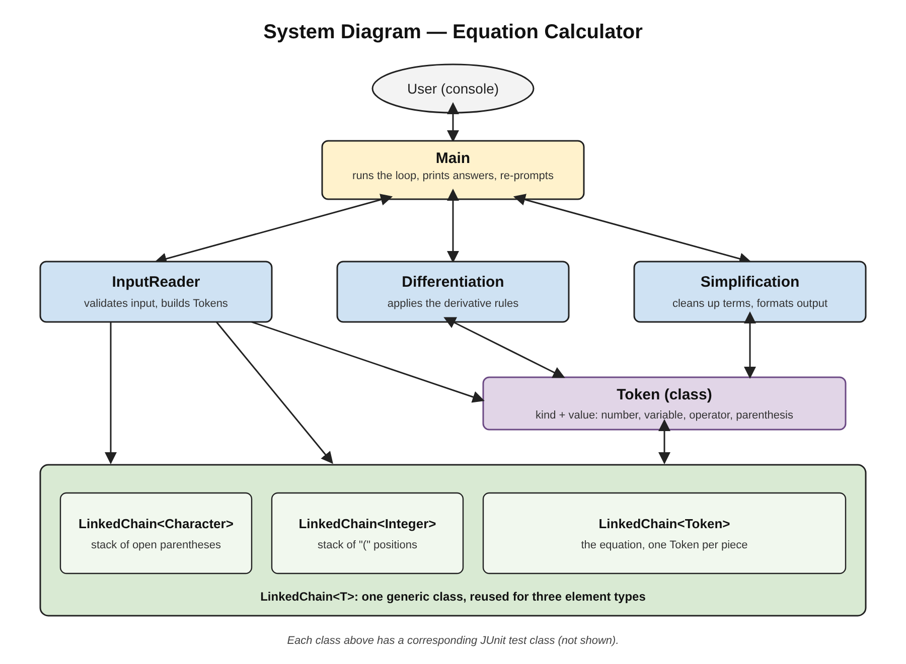

# DerivEasy
A console-based derivative calculator for Calculus students. It differentiates equations in x using the power, product, quotient, and chain rules, plus sin, cos, tan, and ln, and prints a simplified answer.

## How to Compile and Run
1. Put all `.java` files in one project (default package) in Eclipse.
2. Add the JUnit 3 library: right-click the project, Build Path, Add Libraries, JUnit, version 3.
3. Run the program: right-click `Main.java`, Run As, Java Application.
4. Run the tests: right-click the project, Run As, JUnit Test.

Example: type `3*x^2+2*x` and the program prints `6*x + 2`. Type `quit` to exit. Use `x` as the only variable.

## System Diagram

The LinkedChain is one generic class used for three element types: Token (the equation, used by InputReader, Differentiation, Simplification and Main), Character (a stack of open parentheses in `hasParentheses`), and Integer (a stack of "(" positions in `findUnmatchedParenthesis`). All classes use it only through its public API.

## Reflection

**What changed from our specification?**
- Token: we added `equals()`, `toString()`, `setKind()`, and `setValue()`. The null check now throws IllegalArgumentException (spec said NullPointerException) in the constructor and setters, matching the provided LinkedChain.
- Main: the spec listed only `run()`. We added a no-argument constructor, a Scanner constructor so tests can feed fake input, and a `main` method. The class is named Main, not Calculator. `run()` prints "This equation is not supported yet." and re-prompts when Differentiation or Simplification cannot handle a valid input, and uses `findUnmatchedParenthesis` to report which parenthesis has no match.
- Validation: `isValid` only returns a boolean, and `run()` does the re-prompting.
- Dropped the chain interface and the separate Node class, because staff provided LinkedChain.java.
- InputReader: `isValid` also rejects unsupported characters, unmatched or empty parentheses, a leading or trailing operator, two operators in a row, and a missing `*`. `readEquation` throws IllegalArgumentException on invalid input. `hasParentheses` and `findUnmatchedParenthesis` were added and were not in the spec.
- Simplification: removes `^1`, `*1`, `1*`, and `+0`/`-0`, and combines like terms of the form `c*x`. `format` was added to this class, as our revised scope said.
- Differentiation: Token kinds were changed to lowercase so they match every other class (this was a real bug we caught in review). The class now takes the target variable as a second argument, and handles the product, quotient, and chain rules, plus sin, cos, tan, and ln.

**What changed in the LinkedChain?**

Used unchanged. The same generic class holds Token (`readEquation`, `Differentiation`, `Simplification`, Main), Character (`hasParentheses`, a stack of open parentheses called by `isValid`), and Integer (`findUnmatchedParenthesis`, a stack of "(" positions that Main uses to report an unmatched parenthesis).

**What happened to our unknowns?**

We figured out how to split input into Tokens, how to store different element types in one generic chain, how to separate terms and group them with parentheses, how to simplify the final answer, and how to divide up the work.

**Stretch goals**
- Reached: derivatives of sin, cos, tan, and ln.
- Not reached: exp, log, multivariable differentiation, and showing which rule was used.

**Known limitations**
- Division by 0 (for example `1/0`) does not throw an ArithmeticException, so Main's divide-by-zero message is not reached.
- The program always differentiates with respect to `x`. Other letters are treated as constants.
- `exp(x)` is rejected as invalid input, and `log(x)` is accepted but returned unchanged. Only `ln` is supported.
- Some answers are correct but not fully simplified, for example `2*(x + 1)*(1)` for `(x+1)^2`.
- Some quotient-rule answers (for example `x/y`) print a stray `*`.

**Testing**

All JUnit tests pass. Bad input is caught in InputReader (unsupported characters, unmatched or empty parentheses, leading or trailing operators, two operators in a row, missing `*`), and Main prints a message and re-prompts instead of crashing.

## Attribution

| Class/Test file | Who did it | How they did it |
| --- | --- | --- |
| Differentiation | Ari Owen | wrote, revised, reviewed, tested reviewed, revised, tested |
| DifferentiationTestClass | Ari Owen | wrote, revised, reviewed, tested reviewed, revised, tested |
| InputReader | Muna | wrote, revised, reviewed, tested |
| InputReaderTest | Muna | wrote, revised, reviewed, tested |
| LinkedChain | Provided by staff | N/A |
| LinkedChainTest | Owen | wrote, revised, reviewed, tested |
| Main | Owen | wrote, revised, reviewed, tested |
| MainTest | Owen | wrote, revised, reviewed, tested |
| Simplification | Ehren | wrote, revised, reviewed, tested |
| SimplificationTest | Ehren | wrote, revised, reviewed, tested |
| Token | Owen | wrote, revised, reviewed, tested |
| TokenTest | Owen | wrote, revised, reviewed, tested |

**GenAI note:** Owen used Claude as a tutor for the Token class idea, `equals`/`toString`, Main's constructors, the ByteArray technique for testing `run()`, debugging, the system diagram, and to review his test classes, and he reviewed and edited everything himself. Muna: Had Claude help with JUnit testing and implementing the LinkedChain / Token system. Ari: Had Gemini brainstorm ideas on how to separate the terms and debug. Ehren: Had Claude help with logic structure and how best to test.
